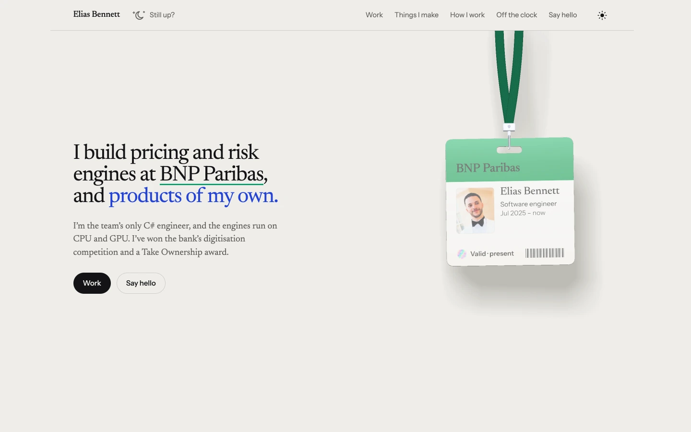
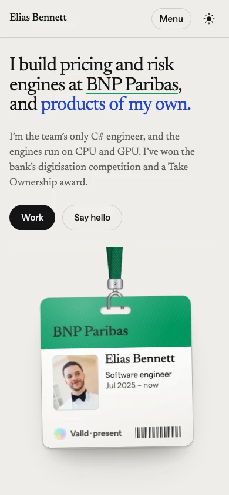
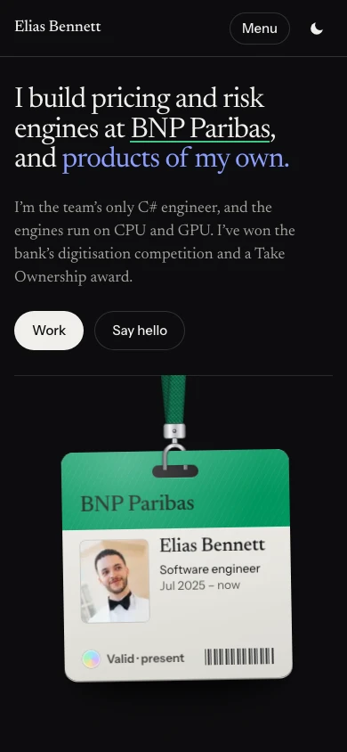
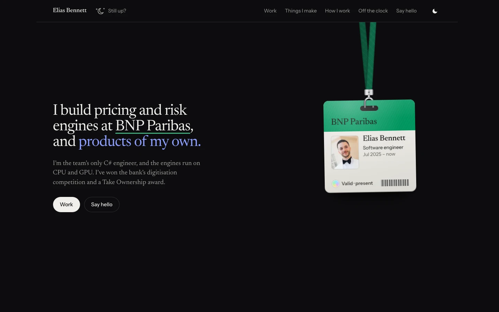
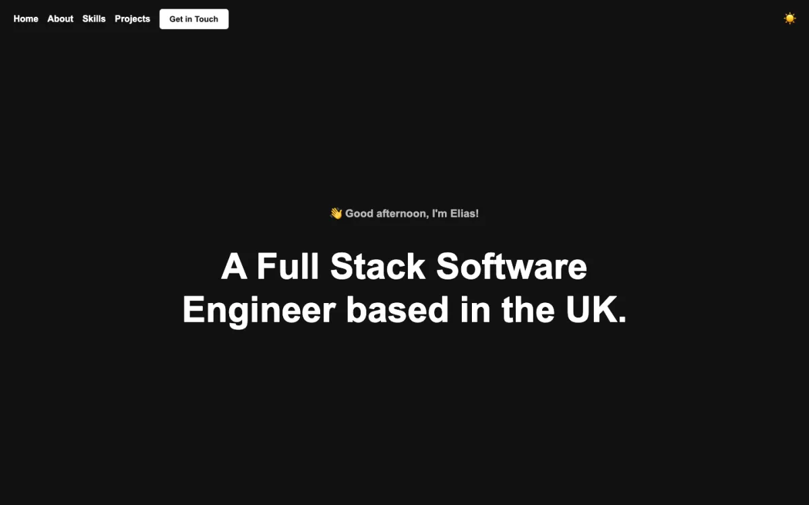
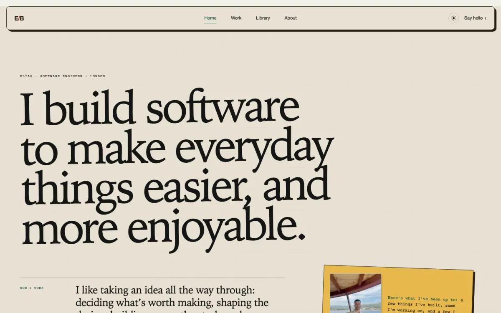
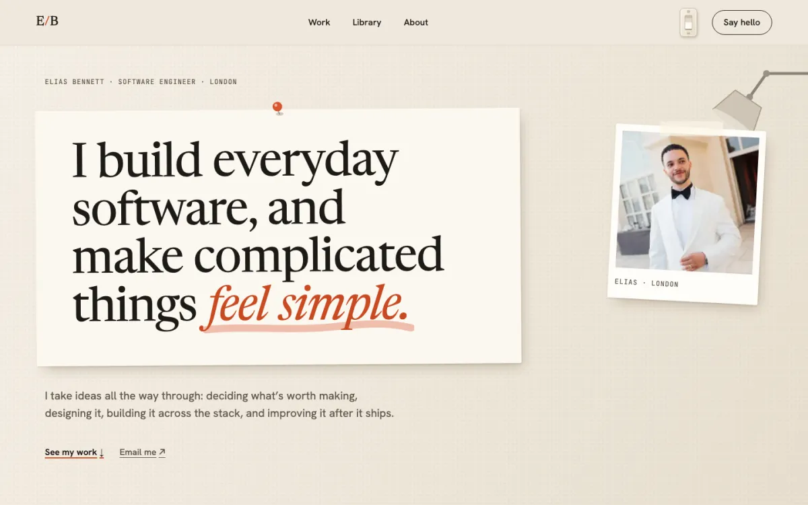
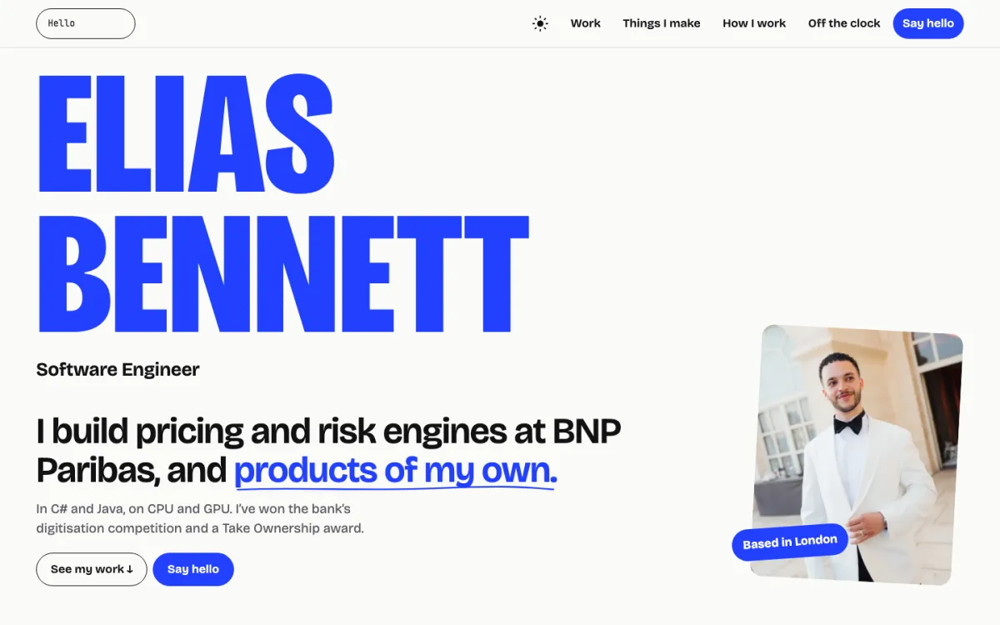
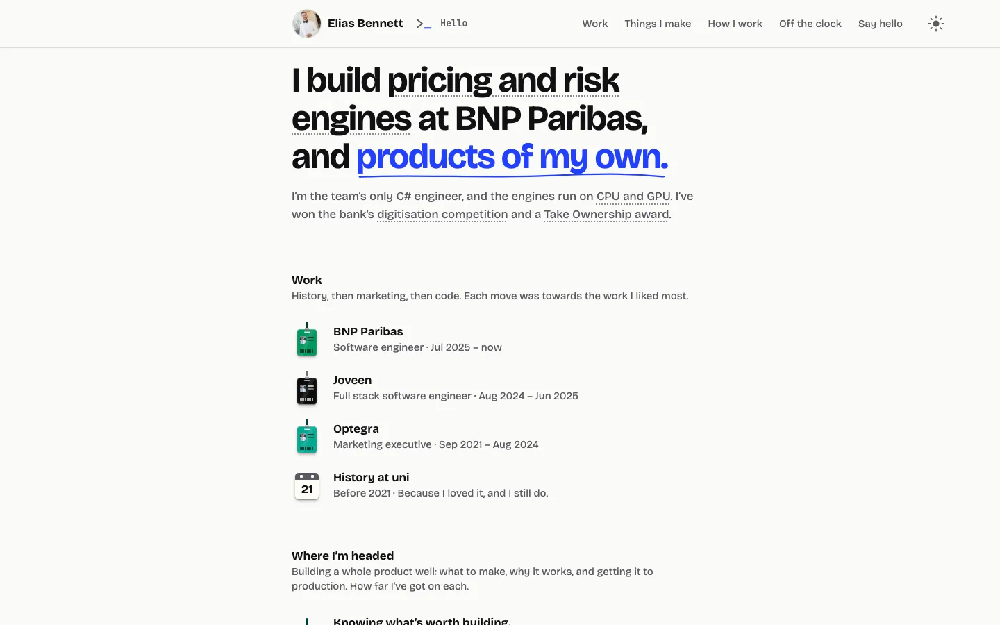

# eliasb.dev

The source of [eliasb.dev](https://www.eliasb.dev), my personal site: what I build, how I work, and what my time looks like away from the keyboard.



I designed the site as **passes and panels**. The first screen is my opening line and my current **Staff pass** (BNP Paribas), hanging from the header as a real ID card (and in 3D where WebGL 2 is available). After that, each subject has a panel sized by how much it matters, in its own colour, with its proof drawn on it: bars to scale, a simulation, a working slice of a product, or a framed screenshot. The page is complete from its first frame, and nothing moves unless it means something. The terms I use in the code and docs are defined in [`GLOSSARY.md`](GLOSSARY.md), and the design contract is [`docs/design/DESIGN.md`](docs/design/DESIGN.md).

| Light | Dark |
| --- | --- |
|  |  |



## How the site changed

I have rebuilt the site five times. Each version below is shown as it stood at its last commit, at 1440 px wide, in its own default theme with its entrance finished. The written design for each of the last three is in [`docs/design/history/`](docs/design/history).

### V1: the first coding project (January 2025)



My first coding project, written by hand in HTML, SCSS and JavaScript: a greeting for the time of day, a skills grid, tabbed experience and a projects grid. It lives on in its own repository, [`3ixas/personal-portfolio-v1`](https://github.com/3ixas/personal-portfolio-v1), and the screenshot is its last content commit. I archived it on 14 September 2026, the day the Cabinet of Curiosities began.

### The Cabinet of Curiosities (September 2026)



The first Next.js build, chosen on 14 September 2026: a clear editorial layout, with tactile objects, real artefacts and a serif display face on top for personality. When I came back to refine it, I judged that it looked good but was "not fully there", and the Board was my answer.

### The Board (September to October 2026)



A well-kept studio wall that I pin things to: the work pinned carefully and clearly, the life around it pinned more loosely, with a typed headline, a lamp and a light switch for the theme. It shipped on 8 October 2026 and I replaced it two days later. I chose a complete redesign over refining it, because the design I first wanted resembled my reference sites and the build had drifted away from them.

### Stretch (October 2026)



A neutral page with one cobalt accent used large, a condensed display face at poster scale, each project in the colours of its own interface, and a two-act typed entrance. My employment came to lead the site, with a Role story for each employer. It grew by addition: every pass added a well-made object and none took one away, until the homepage was a stack of set pieces. The quiet index kept the content and the data layer, and introduced a removal rule ([`QUIET-INDEX.md`](docs/design/history/QUIET-INDEX.md)) so the page stayed small.

### The quiet index (October to November 2026)



One 600 px reading column, one 300 px margin, rows instead of set pieces, closer looks instead of extra blocks, and a length budget the tests enforce. It made the site calm and focused; the next step was to give the strongest work more room and draw its proof on the page.

### Passes and panels (November 2026 to now)

The live site, at the top of this page. The opening hangs the single current BNP Paribas pass, and each subject draws its proof directly on its panel rather than hiding it behind a hover or click. Refined in late November 2026 with full-bleed tonal bands, concentric optical bezels, sticky chapter rails on long-form pages, and a full readiness audit ([`docs/review/APP-AUDIT.md`](docs/review/APP-AUDIT.md)).

## What is on the site

| Route | What it is |
| --- | --- |
| `/` | The homepage: the opening and current Staff pass, then Work, Things I make, Where I'm headed & How I work, Off the clock, and Say hello. Complete from its first frame. |
| `/work/bnp-paribas`, `/work/joveen`, `/work/optegra` | Role stories: one page per employer, opening on its coloured hero and hanging Staff pass, with a sticky chapter rail, Problem and Decision cards, to-scale comparisons and BNP Paribas's Monte Carlo simulation. |
| `/things-i-make` | The Work archive of every project, newest first. `/work` redirects here permanently. |
| `/things-i-make/threshold`, `/things-i-make/argus-risk`, `/things-i-make/flowtime` | Case studies: an open-ground header above a project-coloured exhibition stage, sticky chapter rail, interactive working figures and a PRD card. |
| `/resume` | The résumé sheet, with a committed PDF (`public/Elias-Bennett-Resume.pdf`) that `pnpm verify:resume` keeps in step with the page. |
| `/index.md`, `/llms.txt` | The homepage as Markdown, and a plain-text guide for language models. |
| 404 | A custom not-found page with a Visitor pass showing the address asked for and five links back to the homepage. |

`/about` redirects to `/#work`, `/lab` and `/library` redirect to `/#off-the-clock`, `/work` and `/work/<case-study>` redirect to `/things-i-make`, and `/favicon.ico` redirects to `/icon1.png`.

**Off the clock** is the only section driven by outside data. It opens with Today's workout (authored 7-day schedule and running photo), then what I'm reading (Goodreads) and last watched (Letterboxd), a curiosity from this week in history (Wikipedia's "On this day" and Commons), and GitHub, the past year (with What I'm building now above the contribution grid).

## Stack

- [Next.js](https://nextjs.org) 16 (App Router) and React 19, written in TypeScript
- Tailwind CSS 4 for the reset, with the design in plain CSS custom properties (`src/app/tokens.css`, `parts.css`, and route-split stylesheets)
- Self-hosted Newsreader (subsetted variable Latin WOFF2) and Instrument Sans through `next/font`, used across the whole site including the Résumé sheet and PDF
- [Three.js](https://threejs.org) for the interactive 3D Staff pass, loaded lazily after first paint with parallel texture fetches so the page opens fast, with a CSS printed pass fallback
- CSS custom-property curves (`--out`, `--spring`) for UI motion; [`motion`](https://motion.dev) is a dev-only dependency used by `verify:springs`
- [`@vercel/speed-insights`](https://vercel.com/docs/speed-insights) on the free tier for real-visitor performance data (no cookies)
- A small inline script sets light or dark before paint, so nothing flashes or waits on hydration
- [Playwright](https://playwright.dev) and [`@axe-core/playwright`](https://github.com/dequelabs/axe-core-npm) for end-to-end, visual, forced-colours and WCAG 2.2 AA accessibility tests
- pnpm 10 and Node 24, deployed on Vercel

The architecture decisions are in [`docs/adr/`](docs/adr).

## Run it

You need Node 24 and pnpm 10 (`corepack enable` will pick the pnpm version from `package.json`).

```bash
pnpm install
pnpm dev
```

Then open [http://localhost:3000](http://localhost:3000). The site works with no configuration; every live signal falls back to authored content.

To run the production build:

```bash
pnpm build
pnpm start
```

### Environment

Copy `.env.example` to `.env.local` if you want either of these.

| Variable | Default | What it does |
| --- | --- | --- |
| `GITHUB_SIGNAL_TOKEN` | unset | Optional, server-only, `read:user` scope. Lets the GitHub year show the contribution calendar from my profile. Without it the site uses public events, or an authored fallback. |
| `SITE_INDEXABLE` | `false` | Set `true` only for the production deployment. When false, the site is served with `noindex` and robots disallows crawling. |

Public source identifiers (GitHub, Letterboxd and Goodreads accounts) live in `src/content/integration-config.ts`.

## Live signals and their fallbacks

Each signal is fetched on the server, never in the browser, with a short timeout, a cache window and a shape check. A failure shows authored content instead of an empty row or an error.

| Signal | Source | Cache | If it fails |
| --- | --- | --- | --- |
| GitHub contributions | GitHub GraphQL with the token, else public events | 6 hours | Public-only trace, then an authored state |
| Reading | Goodreads RSS | 30 minutes | "Between books." |
| Last watched | Letterboxd RSS | 15 minutes | "Nothing logged yet." |
| This week in history | Wikipedia "On this day" and Commons image metadata | 7 days | Saved examples, labelled as such |
| Now making | The latest pushed public GitHub repository | 6 hours | Row is omitted (falls back to GitHub profile link if the year is also down) |

The homepage itself revalidates every 15 minutes. The contracts are in [`docs/integrations/SIGNALS.md`](docs/integrations/SIGNALS.md) and the troubleshooting steps in [`docs/runbooks/integration-fallbacks.md`](docs/runbooks/integration-fallbacks.md).

## Tests

End-to-end tests run against a production build, so build first. The suite covers first paint, layout shift, motion, forced colours, worst-case data, theme, contrast, phone layouts, Work, Things I make, How I work, Off the clock, Role stories, Case studies, the archive, the résumé, redirects and the 404, with axe (WCAG 2.2 AA) on every public route and interactive open state. It runs in Chromium and WebKit at 320, 390, 820 and 1440 px wide, in light and dark: 16 projects, so run only what you need.

```bash
SITE_INDEXABLE=true pnpm build
pnpm exec playwright install chromium webkit
pnpm exec playwright test --project=chromium-1440-light e2e/work-archive.spec.ts
```

Playwright starts `pnpm start` itself on port 3100 (change it with `E2E_PORT`) and sets `BOARD_FIXTURES=1`, which turns on the `/fixtures` pages some specs use. Locally it runs one worker at a time; [`docs/runbooks/local-testing.md`](docs/runbooks/local-testing.md) says what to run and what to avoid on a laptop.

`e2e/homepage-signoff.spec.ts` enforces the homepage's length budget (9 screens at 1440 × 900, 12 at 390 × 844), and `pnpm verify:retired` fails if a retired font, token or component from an earlier design comes back.

Static and build checks run by CI (`pnpm check` runs the first group together):

```bash
pnpm lint                    # eslint with --max-warnings 0
pnpm exec tsc --noEmit       # strict TypeScript (no unused locals or parameters)
pnpm verify:signals          # signal adapters, history cache and fallbacks
pnpm verify:catalogue        # project catalogue and links
pnpm verify:copy             # site and machine surfaces match docs/content/redesign-copy.md
pnpm verify:simulation       # Monte Carlo simulation invariants
pnpm verify:flowtime-break   # Flowtime break calculation
pnpm verify:springs          # spring module matches Motion's spring
pnpm verify:craft            # spacing, press, feedback and focus tokens match DESIGN.md
pnpm verify:type-scale       # type scale and 13 px floor
pnpm verify:retired          # nothing retired has come back
pnpm verify:share-assets     # committed share-card assets are fresh
pnpm verify:resume           # the résumé PDF matches /resume
pnpm verify:link-check       # offline tests for the weekly external link check
pnpm verify:playwright-image # Playwright Docker image tag matches pnpm-lock.yaml
pnpm verify:ci-coverage      # every verify script is wired into CI
pnpm check:built             # canonical routes, release headers and JS budget (needs a build)
pnpm verify:first-load       # first-load bytes on a Turbopack build
```

CI (`.github/workflows/quality.yml`) runs `pnpm check` and `pnpm verify:codex-gate`, checks `pnpm check:built` on a webpack build and `pnpm verify:first-load` on a Turbopack build, and splits the Playwright matrix into eight shards. A separate weekly workflow (`.github/workflows/link-check.yml`) checks external links against production. Before pushing to or merging a pull request, read [`docs/runbooks/merging.md`](docs/runbooks/merging.md).

## Project documents

- [`GLOSSARY.md`](GLOSSARY.md): the project's terms, with the retired ones under History
- [`docs/design/DESIGN.md`](docs/design/DESIGN.md): the live design contract, and [`docs/design/history/`](docs/design/history) for the directions it replaced
- [`docs/content/redesign-copy.md`](docs/content/redesign-copy.md): the approved copy
- [`docs/content/IMAGE-CREDITS.md`](docs/content/IMAGE-CREDITS.md): where each image comes from
- [`docs/review/APP-AUDIT.md`](docs/review/APP-AUDIT.md): the latest readiness audit, Lighthouse medians and CI gates
- [`docs/adr/`](docs/adr): architecture decisions
- [`docs/runbooks/`](docs/runbooks): local testing, merging, interruption walk, visual baselines and integration fallbacks
- `docs/discovery`, `docs/review` and the earlier specs are history from earlier designs and passes, kept for reference

## Licence and images

This repository has no licence file, so nothing here is offered for reuse. The photographs and project screenshots are my own; credits are in [`docs/content/IMAGE-CREDITS.md`](docs/content/IMAGE-CREDITS.md).
