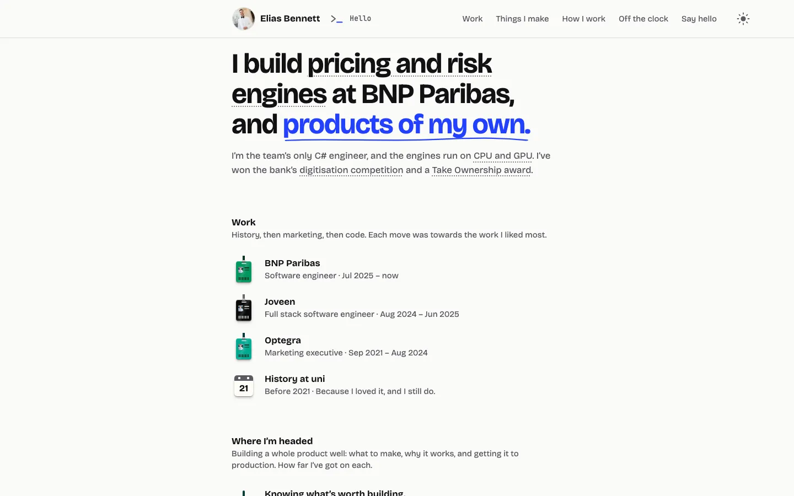
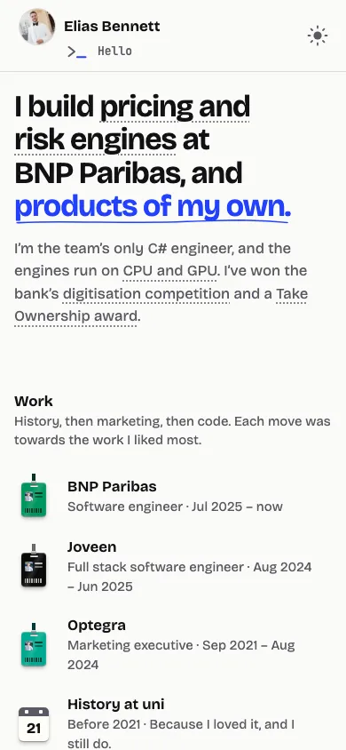
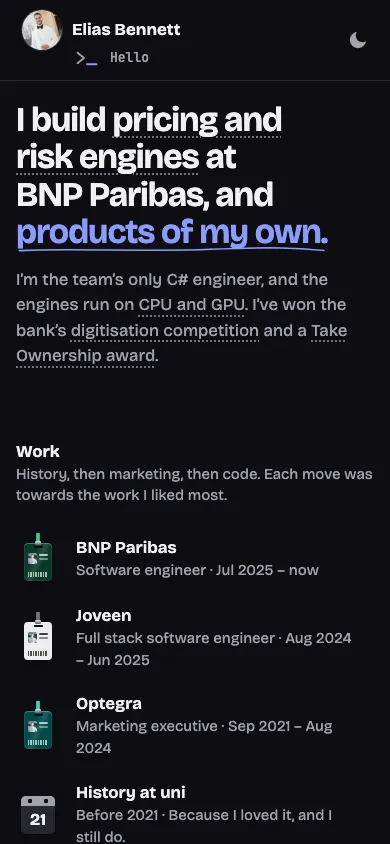
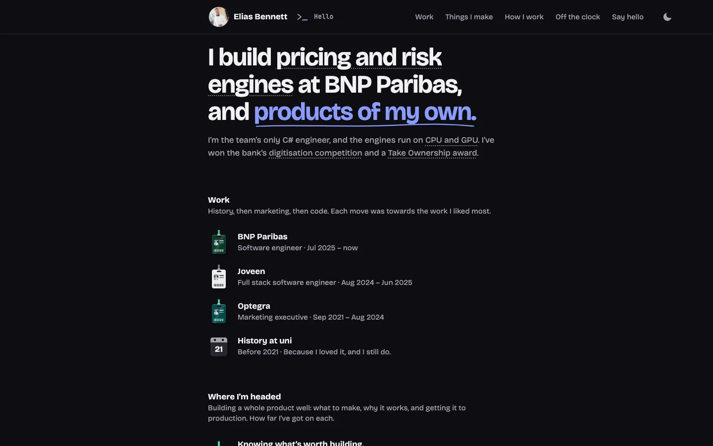
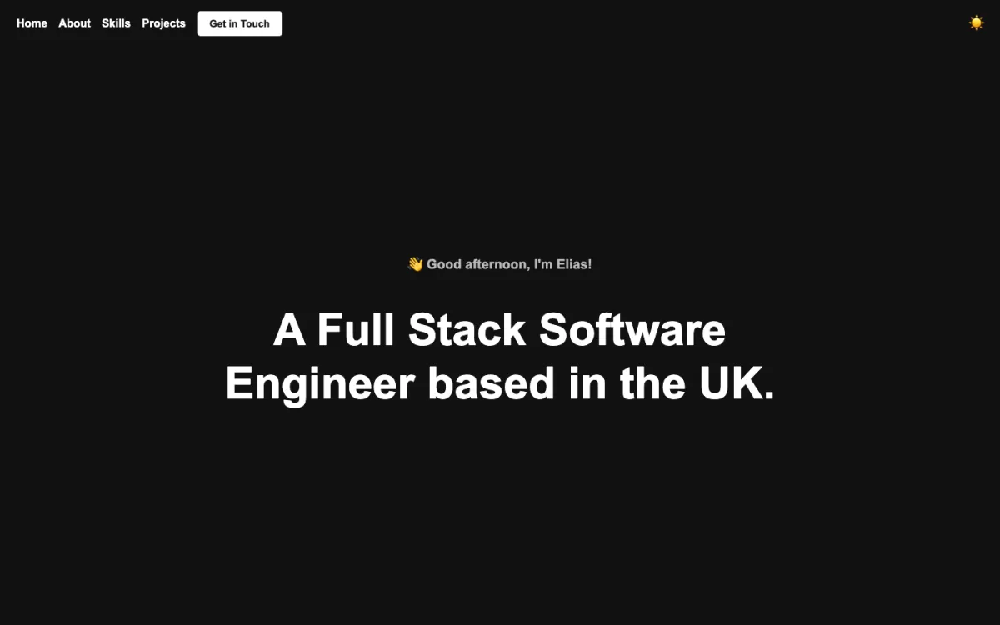
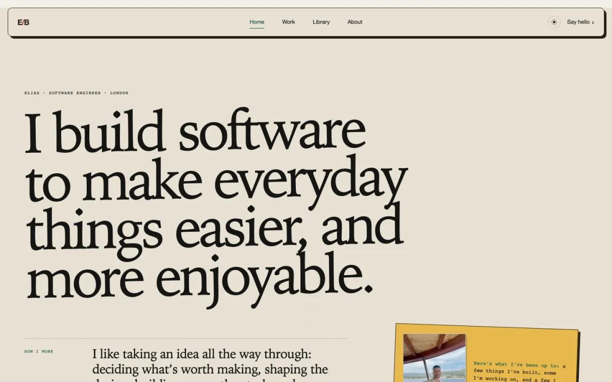
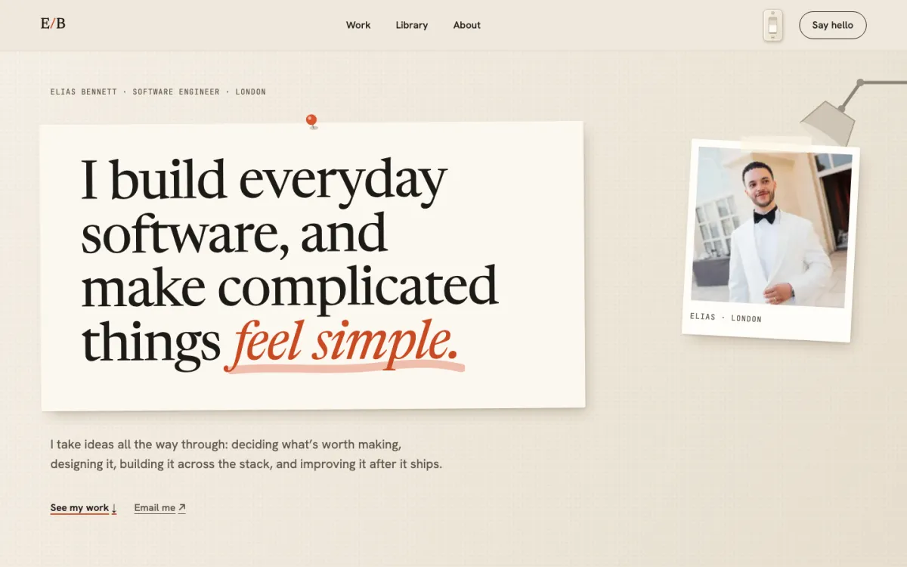
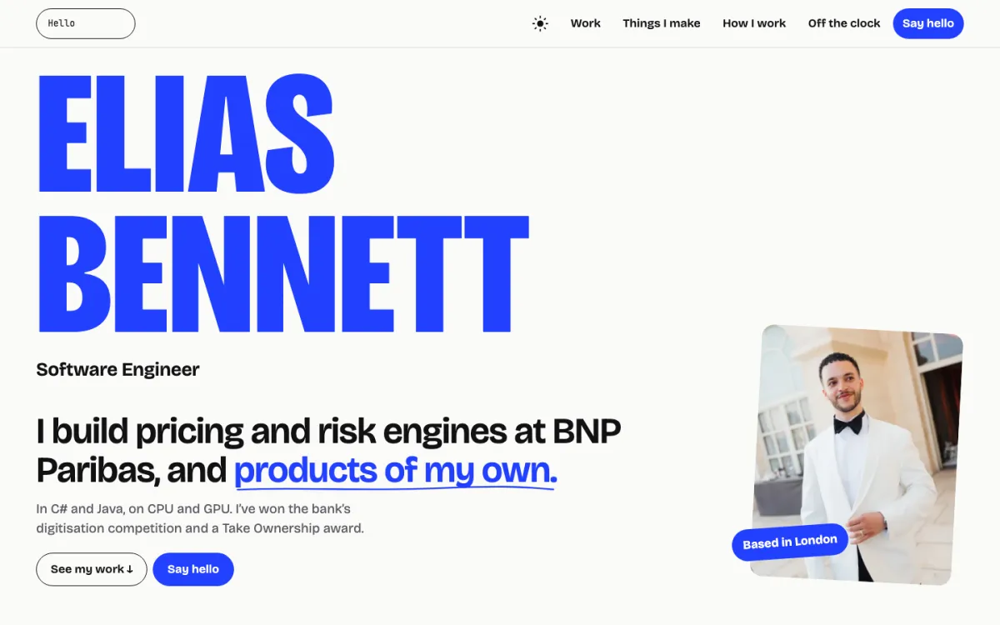

# eliasb.dev

The source of [eliasb.dev](https://www.eliasb.dev), Elias Bennett's personal site: what he builds, how he works, and what his time looks like away from the keyboard.



The site is a **quiet index**: simplicity and focus first, character for whoever looks closer. Every page is one reading column. Anything that names something real (an employer, a project, a book, a film, a habit) is a row, and pointing at the row brings a closer look into the margin; on a phone, tapping it opens the closer look in place. The page is complete from its first frame, and nothing moves unless it means something. The terms used in the code and docs are defined in [`GLOSSARY.md`](GLOSSARY.md), and the design contract is [`docs/design/DESIGN.md`](docs/design/DESIGN.md).

| Light | Dark |
| --- | --- |
|  |  |



## How the site changed

The site has been rebuilt five times. Each version below is shown as it stood at its last commit, at 1440 px wide, in the version's own default theme with its entrance finished. The written contract for each of the last four is in [`docs/design/history/`](docs/design/history).

### V1: the first coding project (January 2025)



Hand-written HTML, SCSS and JavaScript, built as Elias's first coding project: a time-of-day greeting, a skills grid, tabbed experience and a projects grid. It lives on in its own repository, [`3ixas/personal-portfolio-v1`](https://github.com/3ixas/personal-portfolio-v1), and the screenshot is its last content commit. It was archived on 14 September 2026, the day the Cabinet of Curiosities began.

### The Cabinet of Curiosities (September 2026)



The first Next.js build, chosen on 14 September 2026. Clear editorial hierarchy, with tactile objects, real artefacts and a serif display face layered on top for personality. Its refinement brief judged the site good-looking but "not fully there", and the Board was the answer.

### The Board (September to October 2026)



A well-kept studio wall that Elias pins things to: the work pinned carefully and clearly, the life around it pinned more loosely, with a typed headline, a lamp and a light switch for the theme. It shipped on 8 October 2026 and was replaced two days later, because Elias chose a complete redesign over refining it: the design he first wanted resembled his reference sites, and the build had drifted away from them.

### Stretch (October 2026)



A neutral page with one cobalt accent used large, a condensed display face at poster scale, each project in the colours of its own interface, and a two-act typed entrance. Employment came to lead the site, with Role stories for each employer. It grew by addition: every pass added a well-made object and none took one away, until the homepage was a stack of set pieces. It was replaced by the quiet index, which keeps the content and the data layer and adds a [removal rule](docs/design/DESIGN.md#the-removal-rule) so the page stays small.

### The quiet index (October 2026 to now)

The live site, at the top of this page. One 600 px reading column, one 300 px margin, rows instead of set pieces, closer looks instead of extra blocks, and a length budget the tests enforce.

## What is on the site

| Route | What it is |
| --- | --- |
| `/` | The homepage: an opening line, then Work, Things I make, How I work, Off the clock and Say hello. It is complete from its first frame. |
| `/work/bnp-paribas`, `/work/joveen`, `/work/optegra` | Role stories: one page per employer, opening on its staff pass. |
| `/things-i-make` | The archive of every project, newest first. `/work` redirects here. |
| `/things-i-make/threshold`, `/things-i-make/argus-risk`, `/things-i-make/flowtime` | Case studies, each a short visual story with a write-up and a PRD. |
| `/resume` | The résumé, with a PDF (`public/Elias-Bennett-Resume.pdf`) that a check keeps in step with the page. |
| `/index.md`, `/llms.txt` | The homepage as Markdown, and a plain-text guide for language models. |
| 404 | A custom not-found page that shows the address that was missed and five places to go. |

`/about` redirects to `/#work`, and `/lab` and `/library` redirect to `/#off-the-clock`, so old links keep working.

**Off the clock** is the only section driven by outside data. It shows a training week (authored), what Elias is reading (Goodreads), what he last watched (Letterboxd), a curiosity from this week in history (Wikipedia's "On this day" feeds), what he is making now, and a year of GitHub contributions.

## Stack

- [Next.js](https://nextjs.org) 16 (App Router) and React 19, written in TypeScript
- Tailwind CSS 4 for the reset, with the design in plain CSS on custom properties (`src/app/stretch-tokens.css` and the `quiet-*.css` files beside it)
- Bricolage Grotesque and JetBrains Mono through `next/font`
- [Motion](https://motion.dev) for the shared spring that every moving object uses
- The light and dark setting runs from a small inline script, so the page is served finished and nothing is held at first paint
- [Playwright](https://playwright.dev) and axe for end-to-end, accessibility and contrast tests
- pnpm 10 and Node 22, deployed on Vercel

The architecture decisions are in [`docs/adr/`](docs/adr).

## Run it

You need Node 22 and pnpm 10 (`corepack enable` will pick the pnpm version from `package.json`).

```bash
pnpm install
pnpm dev
```

Then open [http://localhost:3000](http://localhost:3000). The site works with no configuration; every live signal falls back to authored content.

To run the production build:

```bash
pnpm build
pnpm start
```

### Environment

Copy `.env.example` to `.env.local` if you want either of these.

| Variable | Default | What it does |
| --- | --- | --- |
| `GITHUB_SIGNAL_TOKEN` | unset | Optional, server-only, `read:user` scope. Lets the GitHub year show the contribution calendar shown on the profile. Without it the site uses public events, or an authored fallback. |
| `SITE_INDEXABLE` | `false` | Set `true` only for the production deployment. When false, the site is served with `noindex` and robots disallows crawling. |

Public source identifiers (GitHub, Letterboxd and Goodreads accounts) live in `src/content/integration-config.ts`.

## Live signals and their fallbacks

Each signal is fetched on the server, never in the browser, with a short timeout, a cache window and a shape check. A failure shows authored content instead of an empty row or an error.

| Signal | Source | Cache | If it fails |
| --- | --- | --- | --- |
| GitHub contributions | GitHub GraphQL with the token, else public events | 6 hours | Public-only trace, then an authored state |
| Reading | Goodreads RSS | 30 minutes | "Between books." |
| Last watched | Letterboxd RSS | 15 minutes | "Nothing logged yet." |
| This week in history | Wikipedia "On this day" and Commons image metadata | 7 days | Saved examples, labelled as such |
| Now making | The latest public GitHub repository | with the page | Nothing: the row is hidden |

The homepage itself revalidates every 15 minutes. The contracts are in [`docs/integrations/SIGNALS.md`](docs/integrations/SIGNALS.md) and the troubleshooting steps in [`docs/runbooks/integration-fallbacks.md`](docs/runbooks/integration-fallbacks.md).

## Tests

End-to-end tests run against a production build, so build first. The suite covers the first frame, sections, Off the clock, theme, contrast, phone layouts, closer looks, Role stories, case studies, the archive, the résumé, redirects and the 404, with axe on the main pages. It runs in Chromium and WebKit at 320, 390, 820 and 1440 px wide, in light and dark: 16 projects, so run only what you need.

```bash
SITE_INDEXABLE=true pnpm build
pnpm exec playwright install chromium webkit
pnpm exec playwright test --project=chromium-1440-light e2e/work-archive.spec.ts
```

Playwright starts `pnpm start` itself on port 3100 (change it with `E2E_PORT`) and sets `BOARD_FIXTURES=1`, which turns on the `/fixtures` pages some specs use. Locally it runs one worker at a time; [`docs/runbooks/local-testing.md`](docs/runbooks/local-testing.md) says what to run and what to avoid on a laptop.

The removal rule is enforced by tests: `e2e/homepage-signoff.spec.ts` fails if the homepage outgrows its length budget or anything but the margin is wider than the column, and `pnpm verify:retired` fails if a retired part of an earlier design returns.

Other checks, which CI also runs. `pnpm check` runs the first group together:

```bash
pnpm lint
pnpm exec tsc --noEmit
pnpm verify:signals      # signal adapters and their fallbacks
pnpm verify:catalogue    # the project catalogue
pnpm verify:copy         # every string matches docs/content/redesign-copy.md
pnpm verify:springs      # the site spring matches Motion
pnpm verify:retired      # nothing retired has come back
pnpm verify:resume       # the résumé PDF matches the page
pnpm check:built         # canonical routes and release markup (needs a build)
```

CI (`.github/workflows/quality.yml`) builds with webpack (`SITE_INDEXABLE=true pnpm build --webpack`) and splits the Playwright matrix into eight shards. Before pushing to or merging a pull request, read [`docs/runbooks/merging.md`](docs/runbooks/merging.md).

## Project documents

- [`GLOSSARY.md`](GLOSSARY.md): the project's terms, with the retired ones under History
- [`docs/design/DESIGN.md`](docs/design/DESIGN.md): the live design contract, and [`docs/design/history/`](docs/design/history) for the directions it replaced
- [`docs/content/redesign-copy.md`](docs/content/redesign-copy.md): the approved copy
- [`docs/content/IMAGE-CREDITS.md`](docs/content/IMAGE-CREDITS.md): where each image comes from
- [`docs/adr/`](docs/adr): architecture decisions
- [`docs/runbooks/`](docs/runbooks): local testing, merging and integration fallbacks
- `docs/discovery`, `docs/review` and the earlier specs are history from earlier designs and are kept for reference

## Licence and images

This repository has no licence file, so nothing here is offered for reuse. The photographs and project screenshots are Elias's own; credits are in [`docs/content/IMAGE-CREDITS.md`](docs/content/IMAGE-CREDITS.md).
